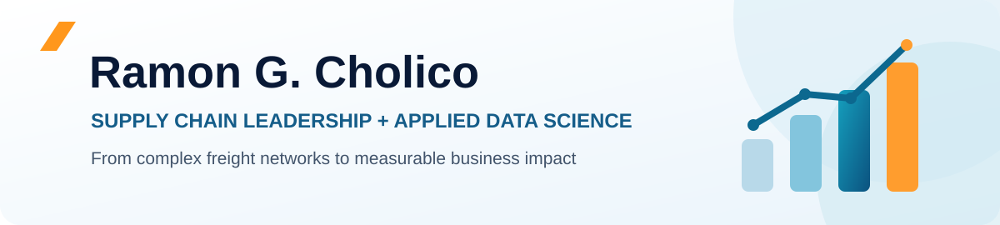

---

## Impact at a Glance

| **20+ Years** | **$88M+** | **378K+** |
|:---:|:---:|:---:|
| Global supply chain leadership | Logistics spend managed | Shipment records analyzed in a distribution network study |

> **Selected project outcomes:** A global forwarder RFQ identified an **$8.43M (65%) freight savings opportunity versus baseline**; an orthopedic freight study modeled **$1.36M+ in annualized savings potential**. These are distinct project-specific figures, not additive realized savings.

## About Me

I bring more than 20 years of global supply chain leadership across medical technology, energy, and offshore industries. My work spans transportation strategy, carrier sourcing, freight spend management, cross-border logistics, and distribution network optimization.

Today, I combine that operational experience with **Python, machine learning, spatial analytics, and financial modeling** to turn complex datasets into practical business decisions.

I'm currently pursuing an **M.S. in Engineering Management & Leadership (Data Science Focus)** at **Rice University**, where I also serve as a graduate teaching assistant.

## Featured Case Studies

<table>
<tr>
<td width="33%" valign="top">

 <strong>Global Forwarder Sourcing RFQ</strong> 
Four forwarders · 826 container moves · <strong>$8.43M modeled savings vs. baseline (65%)</strong>. 
<a href="https://github.com/rcholico/Global-Freight-Forwarder-Procurement-RFQ">Explore case study</a>
</td>
<td width="33%" valign="top">

 <strong>Distribution Center Optimization</strong> 
<strong>378K+</strong> shipments · K-Means clustering · network location and shipping-zone analysis. 
<a href="https://github.com/rcholico/DC-Relocation">Explore case study</a>
</td>
<td width="33%" valign="top">

 <strong>Orthopedic Freight Optimization</strong> 
Express-to-Ground and service-level changes · <strong>$1.36M+ modeled annual savings potential</strong>. 
<a href="https://github.com/rcholico/Orthopedic-Implants-Freight-Spend-Optimization">Explore case study</a>
</td>
</tr>
</table>

## Explore All Nine Projects

### Network & Transportation Optimization

| Project | Analytical focus |
|---|---|
| [Distribution Center Location Optimization](https://github.com/rcholico/DC-Relocation) | K-Means clustering, spatial analysis, and distribution network design across 378K+ shipments |
| [US Zone Skipping & Air-Bulk Optimization](https://github.com/rcholico/US-Zone-Skipping-Air-Bulk-Optimization) | Alternative parcel injection and transit-time scenarios for Northeast deliveries |
| [US–Canada Direct Parcel Injection](https://github.com/rcholico/US-Canada-CrossBorder-Purolator-Injection) | Cross-border sourcing and a 19.7% lower cost-per-shipment comparison |
| [International Multimodal Transportation Analysis](https://github.com/rcholico/International-Freight-Network-Analysis) | Ocean versus rail-and-ocean trade-offs; a modeled 21-day transit-time advantage |

### Cost Analytics & Strategic Sourcing

| Project | Analytical focus |
|---|---|
| [Global Forwarder Sourcing RFQ](https://github.com/rcholico/Global-Freight-Forwarder-Procurement-RFQ) | Four-bid comparison across 826 container moves; $8.43M modeled savings versus baseline |
| [Orthopedic Implants Freight Optimization](https://github.com/rcholico/Orthopedic-Implants-Freight-Spend-Optimization) | Mode-shift and service-level analysis; $1.36M+ modeled annualized savings potential |
| [Fuel Surcharge Sensitivity Model](https://github.com/rcholico/Geopolitical-Risk-Fuel-Sensitivity-Model) | Fuel-price scenarios and $271K+ potential freight surcharge exposure |

### Data Analytics & Governance

| Project | Analytical focus |
|---|---|
| [Parcel Supply Chain Analytics](https://github.com/rcholico/Parcel-SupplyChain-Analytics) | Python-driven dimensional-weight, carrier performance, zone, and shipment-density analysis |
| [Global Freight Auditor Selection](https://github.com/rcholico/Freight-Auditor-Selection) | Freight audit platform evaluation, vendor requirements, data ownership, and AI privacy governance |

## Technical Toolkit

| Area | Tools & Methods |
|---|---|
| **Data Science & ML** | Python · Pandas · NumPy · Scikit-learn · K-Means clustering · SQL |
| **Analytics & Optimization** | Freight cost modeling · Sensitivity analysis · Spatial analytics · Network design · Scenario evaluation |
| **Enterprise & Integration** | ProShip API · Transportation Management Systems · SAP / Oracle · Git / GitHub · LLM workflows |
| **Business Leadership** | Global logistics · Strategic sourcing · Carrier governance · Cross-border transportation · Freight audit |

## Education & Leadership

- **Rice University** — M.S. in Engineering Management & Leadership, Data Science Focus *(in progress)*; Graduate Teaching Assistant
- **EGADE Business School, Tecnológico de Monterrey** — OneMBA Global Executive MBA; Beta Gamma Sigma Honor Society
- **Tecnológico de Monterrey** — B.S. in Industrial & Systems Engineering

---

### Let's Connect

Interested in using analytics to solve complex supply chain challenges?

[**Portfolio Website**](https://rcholico.github.io/) · [**LinkedIn**](https://www.linkedin.com/in/ramon-cholico) · [**GitHub Projects**](https://github.com/rcholico?tab=repositories) · [**Email Me**](mailto:rcholico@hotmail.com)

